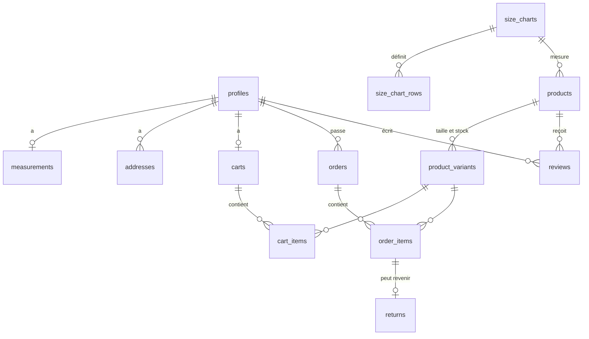

# Carrure

Boutique en ligne de chemises et de costumes pour homme. Le client crée un compte, donne sa taille, son poids et son âge, et la boutique lui montre les articles en stock dans **sa** taille. La taille vient d'un calcul déterministe et s'affiche comme une estimation, avec un niveau de confiance.

Projet étudiant : Next.js 16, Supabase (Postgres, Auth, RLS), déploiement Vercel.

- **Démo en ligne :** _à renseigner après le déploiement Vercel_ (voir [Déploiement](#déploiement-sur-vercel)).
- **Comptes de test** (créés par le seed, mot de passe `carrure-demo`) :
  - client : `client@carrure.test` (mensurations saisies, une commande livrée) ;
  - admin : `admin@carrure.test` (tableau de bord et fiches produit).

Ce mot de passe est public. Changez-le avant toute mise en ligne réelle.

## Démo en trois minutes

1. **Inscription** sur `/inscription`, puis **profil** : taille, poids, âge (tour de poitrine et coupe préférée en option).
2. On arrive sur **`/costumes`**, onglet **« Pour moi »** : seuls les costumes en stock dans la taille calculée, les plus sûrs d'abord.
3. **Fiche produit** : bandeau « Votre taille », choix de la taille, **Ajouter au panier**. Le bouton « Pourquoi cette taille ? » appelle le conseiller IA.
4. **Panier** (enregistré en base), **commande** avec paiement simulé, puis **historique** dans `/compte/commandes`, avec demande de retour.
5. Connexion en **admin** : `/admin` affiche le CA, le panier moyen, les meilleures ventes, le taux de retour pour mauvaise taille, les tailles les plus vendues et les nouveaux clients. `/admin/produits` rédige une fiche avec l'IA.

## Installation

Prérequis : Node 20+, pnpm, Docker (pour Supabase en local).

```bash
pnpm install
cp .env.example .env.local          # puis remplir les valeurs
npx supabase start                  # Postgres, Auth et API en local ; affiche l'URL et la clé anon
npx supabase db reset               # applique les migrations et le seed
pnpm dev                            # http://localhost:3000
```

Vérifications :

```bash
pnpm lint && pnpm exec tsc --noEmit # ESLint et TypeScript strict
pnpm test                           # tests unitaires (calcul de taille, filtre « Pour moi », validation)
npx supabase test db                # tests pgTAP : RLS, contraintes, commande (24 tests)
bash supabase/tests/oversell.sh     # deux achats simultanés du dernier article : un seul passe
pnpm build
```

## Variables d'environnement

| Variable | Où | Rôle |
| --- | --- | --- |
| `NEXT_PUBLIC_SUPABASE_URL` | navigateur et serveur | URL du projet Supabase |
| `NEXT_PUBLIC_SUPABASE_ANON_KEY` | navigateur et serveur | clé publique, protégée par la RLS |
| `ANTHROPIC_API_KEY` | serveur uniquement | clé de l'API Claude pour les deux skills IA ; sans elle le site marche, l'IA affiche « non activé » |
| `NEXT_PUBLIC_SITE_URL` | facultatif | URL publique (sitemap, robots.txt, image de partage). Sur Vercel, `VERCEL_PROJECT_PRODUCTION_URL` suffit |
| `NEXT_PUBLIC_CONTACT_EMAIL` | facultatif | adresse affichée sur la page Confidentialité pour exercer ses droits. **À renseigner avant une mise en ligne publique** |

Aucune clé secrète n'est dans le dépôt : `.env*` est ignoré par git, seul `.env.example` (sans valeur) est versionné. La clé `service_role` de Supabase n'est jamais utilisée par l'application.

## Déploiement sur Vercel

1. Créer un projet Supabase, puis pousser le schéma : `npx supabase link --project-ref <ref>` et `npx supabase db push`. Exécuter `supabase/seed.sql` dans l'éditeur SQL pour les données de démo.
2. Dans Supabase > Authentication > URL Configuration, mettre l'URL Vercel en *Site URL* et ajouter `<url>/auth/confirm` aux *Redirect URLs*.
3. Importer le dépôt sur Vercel et renseigner les trois variables ci-dessus dans *Settings > Environment Variables* (Production et Preview).
4. Dans Vercel > *Analytics*, activer Web Analytics (le composant n'est chargé que sur Vercel).
5. Déployer, puis reporter l'URL publique en haut de ce README.

## Avant la mise en ligne : les 20 points

| Point | Où |
| --- | --- |
| Page RGPD | `/confidentialite` |
| CGU et mentions légales | `/cgu` |
| API côté serveur | clé Claude lue seulement dans `lib/ai.ts` ; clé Supabase publique protégée par la RLS |
| HTTPS forcé | Vercel redirige HTTP vers HTTPS (308) ; en-têtes HSTS et de sécurité dans `next.config.ts` |
| Bandeau cookies | `components/cookie-notice.tsx` : information seule, car seuls des cookies de connexion (exemptés par la CNIL) sont déposés |
| Meta title et description | `metadata` du layout et de chaque page |
| Image réseaux | `app/opengraph-image.jpg` ; la photo de l'article sur chaque fiche |
| Favicon | `app/favicon.ico`, `app/icon.png`, `app/apple-icon.png` |
| Sitemap et robots.txt | `app/sitemap.ts`, `app/robots.ts` (pages privées exclues) |
| Textes alternatifs | photos produit décrites ; images décoratives en `alt=""` |
| Images compressées | `next/image` sert de l'AVIF ou du WebP (14 Ko au lieu de 118 Ko pour une photo en 640 px) |
| Vitesse | Lighthouse mobile 93 à 99 en performance |
| Contraste | Lighthouse accessibilité 100 |
| Responsive | vérifié de 320 à 1440 px |
| Page 404 | `app/not-found.tsx` |
| Liens cassés | parcours automatique de 199 pages (visiteur, client, admin) : aucun |
| Validation des formulaires | Zod côté serveur (`lib/validation.ts`) et contraintes SQL |
| Anti-spam | pot de miel à l'inscription, limites de Supabase Auth, 20 appels IA par heure et par compte (`consume_ai_quota`) |
| Analytics | Vercel Web Analytics, sans cookie, numéros de commande masqués |
| Un seul CTA | un bouton principal par écran |

Données « pire cas » pour tester l'interface : `supabase/fixtures/worst-case.sql` (compte `pire@carrure.test`). `supabase db reset` remet les données de démo.

## Base de données

Migrations versionnées dans `supabase/migrations/`, seed dans `supabase/seed.sql` (30 produits fictifs, 2 comptes de test, 12 clients fictifs, environ 60 commandes et leurs retours).



- **Contraintes** : clés primaires et étrangères partout ; `NOT NULL`, `CHECK` (bornes des mensurations, stock ≥ 0, quantité 1 à 10, note 1 à 5, code postal) et `UNIQUE` (un panier par client, une taille par produit, un avis par client et par produit, un retour par ligne). Un trigger refuse une variante dont la taille n'existe pas dans le tableau du produit, un autre refuse un retour sur la commande d'un autre client.
- **Index** sur les colonnes filtrées ou jointes : catégorie des produits actifs, commandes par client et par date, lignes par variante, retours par motif.
- **Copies figées** : une commande garde l'adresse, le nom et le prix au moment de l'achat. Modifier une fiche ne réécrit pas l'historique.
- **RLS activée sur toutes les tables.** Un client ne lit que son profil, ses mensurations, ses adresses, son panier, ses commandes et ses retours. Le catalogue et les avis sont publics en lecture. Un avis n'est accepté que d'un acheteur du produit. Un client ne peut pas se donner le rôle admin : seule la colonne `full_name` de `profiles` lui est ouverte.
- **Rôle admin** : colonne `profiles.role`, lue par la fonction `is_admin()`. Les pages `/admin` vérifient le rôle côté serveur (`requireAdmin()` dans `lib/commerce.ts`) et répondent « introuvable » aux autres ; la RLS bloque de toute façon leurs requêtes.
- **KPIs en SQL** : vues `admin_kpis`, `admin_top_products`, `admin_sizes_sold`, `admin_returns_by_reason`, en `security_invoker` pour que la RLS de l'appelant s'applique. La page admin ne fait qu'afficher.

### La commande sans survente : `place_order()`

Fonction SQL (`supabase/migrations/20261023140000_commerce.sql`) appelée par l'action serveur de paiement. Tout se passe dans **une seule transaction** :

1. elle verrouille les variantes du panier avec `SELECT … FOR UPDATE`, dans l'ordre des identifiants pour éviter les interblocages : une autre commande sur la même taille attend ;
2. elle vérifie le stock sous verrou et refuse toute la commande si une ligne manque (« Stock insuffisant : Costume gris anthracite (52) ») ;
3. elle crée la commande et ses lignes, décrémente le stock et vide le panier.

Si une étape échoue, rien n'est écrit. La contrainte `CHECK (stock >= 0)` reste le dernier filet. Le script `supabase/tests/oversell.sh` lance deux achats simultanés du dernier article : un seul aboutit, le stock finit à 0.

## Le calcul de taille

Code : `lib/sizing.ts`, testé dans `lib/sizing.test.ts`. Il est **déterministe** : mêmes mensurations, même taille.

1. **Tours de corps.** Le tour de poitrine et le tour de taille saisis sont utilisés tels quels. S'ils manquent, ils sont estimés à partir de la taille, du poids (IMC) et de l'âge. Cette formule est une heuristique maison, non validée scientifiquement : la taille est alors marquée « estimée ».
2. **Aisance.** Une coupe ajustée demande 2 cm de plus, une coupe ample 2 cm de moins ; la coupe préférée du client joue en sens inverse.
3. **Choix de la taille.** Chaque ligne du tableau de tailles du produit reçoit un écart : distance au tour de poitrine, plus la moitié de la distance au tour de taille pour un costume. La ligne la plus proche gagne. Au-delà de 4 cm d'écart, aucune taille n'est proposée.
4. **Confiance.** Élevée par défaut. Elle baisse d'un cran si les tours sont estimés, d'un cran si le client est à moins de 1,5 cm d'une limite (la taille voisine est alors indiquée).

Le filtre **« Pour moi »** (`lib/shop.ts`) garde les articles en stock dans la taille calculée, les plus sûrs d'abord, puis la coupe préférée.

## Les skills IA

Code : `lib/ai.ts`. Les appels partent **uniquement du serveur** (actions serveur Next.js), avec le SDK officiel `@anthropic-ai/sdk` et le modèle `claude-opus-5-5`. Délai de 25 s par tentative, une seule nouvelle tentative, sortie JSON validée par un schéma Zod. Chaque erreur (clé absente, délai dépassé, quota, refus, panne) donne un message clair au lieu d'une page cassée.

### 1. Conseiller taille et style (fiche produit)

Le bouton « Pourquoi cette taille ? » envoie à l'IA **le résultat du calcul** (taille, taille voisine, confiance, tours mesurés ou estimés) et la liste des articles en stock dans la taille du client. L'IA explique ce résultat en quelques phrases et compose jusqu'à trois tenues.

- **Elle ne calcule pas la taille** : la consigne le lui interdit, et l'interface affiche toujours la taille issue de `lib/sizing.ts`.
- **Elle ne peut pas inventer d'article** : seuls les slugs présents dans la liste fournie sont gardés côté serveur.
- **Valeur ajoutée** : le client comprend pourquoi on lui conseille un 50 plutôt qu'un 52 (et qu'il gagnerait à mesurer son tour de poitrine), ce qui doit faire baisser les retours pour mauvaise taille. Les tenues font monter le panier moyen avec des articles qui lui vont.

### 2. Rédaction des fiches produit (admin)

Sur `/admin/produits/<slug>`, l'admin demande une description. L'IA la rédige à partir des seules caractéristiques du produit (nom, coupe, couleur, matière, notes de l'admin), sans provenance ni label inventés. Le texte arrive dans un champ modifiable : **rien n'est publié avant que l'admin ait relu et cliqué sur « Publier »**.

- **Valeur ajoutée** : 30 fiches homogènes, dans le ton de la marque, en quelques minutes, avec un humain qui garde la main.

## Structure

```
app/
  (boutique)/        costumes, chemises, fiche produit, conseiller IA, avis
  (auth)/            connexion, inscription
  panier/ commande/  panier persistant, paiement simulé
  compte/            mensurations, commandes, retours
  admin/             tableau de bord, fiches produit
components/          composants d'interface partagés
lib/                 calcul de taille, catalogue, commerce, IA, validation (Zod)
supabase/            migrations, seed, tests pgTAP et test de survente
```

## Crédits photos

Aucune personne sur les photos : chaque article est montré seul, sur cintre, sur le même fond. Les 30 visuels partent de trois photos [Pexels](https://www.pexels.com/license/), libres d'utilisation, attribution non requise :

| Base | Photo | Sert à |
| --- | --- | --- |
| Veste droite beige sur cintre | [pexels.com/photo/32427323](https://www.pexels.com/photo/32427323/) | les 10 costumes droits (le costume en lin beige est la photo d'origine) |
| Veste croisée blanche sur cintre | [pexels.com/photo/37987847](https://www.pexels.com/photo/37987847/) | le costume croisé et le smoking |
| Chemise bleu ciel sur cintre | [pexels.com/photo/9558723](https://www.pexels.com/photo/9558723/) | les 18 chemises |

Chaque base est détourée (modèle isnet-general-use via rembg), puis teinte dans la couleur du produit et, pour les tissus à motif (rayures, vichy, carreaux, prince-de-galles, tweed, chiné), recouverte d'un motif dessiné par programme. Les plis de la photo d'origine sont conservés ; la teinte moyenne de chaque vêtement est calée sur celle annoncée dans la fiche. Ce sont donc des visuels d'illustration, pas des photos des articles. Scripts : `scripts/photos/shirt-cutout.py` et `scripts/photos/generate.py`. À remplacer par de vraies photos produit avant toute utilisation commerciale.
