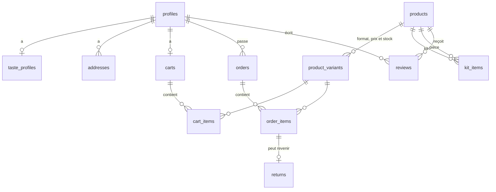

# USUCHA

Boutique en ligne de kits pour préparer le matcha chez soi : fouet en bambou (chasen), cuillère (chashaku), tamis, bol, bouilloire, et le matcha lui-même en trois grades. Le client remplit un **profil de goût** ; un calcul déterministe classe la boutique pour lui, donne la durée d'une boîte à son rythme et le prix de revient de sa tasse.

Projet étudiant réalisé en binôme avec Ilian : Next.js 16, Supabase (Postgres, Auth, RLS), GSAP, WebGL, déploiement Vercel.

- **Démo en ligne :** _à renseigner après le déploiement Vercel_ (voir [Déploiement](#déploiement-sur-vercel)).
- **Comptes de test** (créés par le seed, mot de passe `usucha-demo`) :
  - client : `client@usucha.test` (profil de goût rempli, une commande livrée) ;
  - admin : `admin@usucha.test` (tableau de bord et fiches produit).

Ce mot de passe est public. Changez-le avant toute mise en ligne réelle. Les produits et les prix sont fictifs.

## Démo en trois minutes

1. **Accueil** : un tas de vraie poudre de matcha qu'on écarte du doigt ou à la souris ; « Kit Essentiel · 49 € » ouvre la fiche du kit. En défilant : la planche de 12 photos (une case s'agrandit au toucher), les pièces saisies (une ligne de l'inventaire change la photo), la préparation épinglée en 4 photos (tamiser, verser, fouetter, servir), le calcul du prix de la tasse, la chaîne feuille, poudre (qu'on touche aussi), boîte, puis la boîte qu'on tapote pour servir des tasses, et les 4 kits.
2. **Inscription** sur `/inscription`, puis **profil de goût** : six réponses. Le relevé à droite se recalcule à chaque clic (kit et matcha conseillés, prix de la tasse, économie mensuelle).
3. **Boutique** `/boutique`, vue **« Pour moi »** : les articles qui conviennent, le mieux noté d'abord, avec leur score sur 100.
4. **Fiche produit** : photo à inspecter à la loupe (souris ou doigt), bloc « Pour vous » (score et raisons), relevé chiffré du format choisi, **Ajouter au panier**. Le bouton « Pourquoi ce score ? » appelle le conseiller IA.
5. **Panier** (enregistré en base), **commande** avec paiement simulé, **historique** dans `/compte/commandes`, demande de retour.
6. Connexion en **admin** : `/admin` affiche le CA, le panier moyen, les meilleures ventes, le taux de retour pour casse, la part des clients avec un profil de goût et les formats les plus vendus. `/admin/produits` rédige une fiche avec l'IA.

## Installation

Prérequis : Node 20+, pnpm, Docker (pour Supabase en local).

```bash
pnpm install
cp .env.example .env.local          # puis remplir les valeurs
npx supabase start                  # Postgres, Auth et API en local ; affiche l'URL et la clé anon
npx supabase db reset               # applique les migrations et le seed
pnpm dev                            # http://localhost:3000
```

Vérifications :

```bash
pnpm lint && pnpm exec tsc --noEmit # ESLint et TypeScript strict
pnpm test                           # tests unitaires : recommandation, profil de goût, boutique, validation (31 tests)
npx supabase test db                # tests pgTAP : RLS, contraintes, commande (30 tests)
bash supabase/tests/oversell.sh     # deux achats simultanés du dernier coffre : un seul passe
pnpm build
```

## Variables d'environnement

| Variable | Où | Rôle |
| --- | --- | --- |
| `NEXT_PUBLIC_SUPABASE_URL` | navigateur et serveur | URL du projet Supabase |
| `NEXT_PUBLIC_SUPABASE_ANON_KEY` | navigateur et serveur | clé publique, protégée par la RLS |
| `ANTHROPIC_API_KEY` | serveur uniquement | clé de l'API Claude pour les deux skills IA ; sans elle le site marche, l'IA affiche « non activé » |
| `NEXT_PUBLIC_SITE_URL` | facultatif | URL publique (sitemap, robots.txt, image de partage). Sur Vercel, `VERCEL_PROJECT_PRODUCTION_URL` suffit |
| `NEXT_PUBLIC_CONTACT_EMAIL` | facultatif | adresse affichée sur la page Confidentialité pour exercer ses droits. **À renseigner avant une mise en ligne publique** |

Aucune clé secrète n'est dans le dépôt : `.env*` est ignoré par git, seul `.env.example` (sans valeur) est versionné. La clé `service_role` de Supabase n'est jamais utilisée par l'application.

## Déploiement sur Vercel

1. Créer un projet Supabase, puis pousser le schéma : `npx supabase link --project-ref <ref>` et `npx supabase db push`. Exécuter `supabase/seed.sql` dans l'éditeur SQL pour les données de démo.
2. Dans Supabase > Authentication > URL Configuration, mettre l'URL Vercel en *Site URL* et ajouter `<url>/auth/confirm` aux *Redirect URLs*.
3. Importer le dépôt sur Vercel et renseigner les trois variables ci-dessus dans *Settings > Environment Variables* (Production et Preview).
4. Dans Vercel > *Analytics*, activer Web Analytics (le composant n'est chargé que sur Vercel).
5. Déployer, puis reporter l'URL publique en haut de ce README.

## Avant la mise en ligne : les 20 points

| Point | Où |
| --- | --- |
| Page RGPD | `/confidentialite` |
| CGU et mentions légales | `/cgu` |
| API côté serveur | clé Claude lue seulement dans `lib/ai.ts` ; clé Supabase publique protégée par la RLS |
| HTTPS forcé | Vercel redirige HTTP vers HTTPS (308) ; en-têtes HSTS et de sécurité dans `next.config.ts` |
| Bandeau cookies | `components/cookie-notice.tsx` : information seule, car seuls des cookies de connexion (exemptés par la CNIL) sont déposés |
| Meta title et description | `metadata` du layout et de chaque page |
| Image réseaux | `app/opengraph-image.jpg` (l'accueil et sa poudre) ; la photo de l'article sur chaque fiche |
| Favicon | `app/favicon.ico`, `app/icon.png`, `app/apple-icon.png` |
| Sitemap et robots.txt | `app/sitemap.ts`, `app/robots.ts` (pages privées exclues) |
| Textes alternatifs | photos produit décrites par le nom de l'article ; poudre et photos décoratives en `aria-hidden`, leur contenu existe en texte |
| Images compressées | `next/image` sert de l'AVIF ou du WebP à la bonne taille |
| Vitesse | la poudre interactive ne tourne que visible à l'écran et s'arrête quand rien ne bouge ; moins de grains sur téléphone |
| Contraste | jetons vérifiés dans `app/globals.css` (texte secondaire 5,5:1 sur l'acier, 8:1 sur le noir) |
| Responsive | vérifié à 390 et 1440 px de large, sans défilement horizontal |
| Page 404 | `app/not-found.tsx` (« Bol vide ») |
| Liens cassés | parcours automatique des pages principales, connecté et déconnecté |
| Validation des formulaires | Zod côté serveur (`lib/validation.ts`, `lib/taste.ts`) et contraintes SQL |
| Anti-spam | pot de miel à l'inscription, limites de Supabase Auth, 20 appels IA par heure et par compte (`consume_ai_quota`) |
| Analytics | Vercel Web Analytics, sans cookie, numéros de commande masqués |
| Un seul CTA | un bouton principal (vert) par écran |

Données « pire cas » pour tester l'interface : `supabase/fixtures/worst-case.sql` (compte `pire@usucha.test`). `supabase db reset` remet les données de démo.

## Base de données

Migrations versionnées dans `supabase/migrations/`, seed dans `supabase/seed.sql` (17 produits fictifs, 2 comptes de test, 12 clients fictifs, environ 60 commandes et leurs retours).



- **Catalogue** : un produit est un kit, un matcha ou un ustensile. Des `CHECK` imposent la cohérence (un ustensile a un type, un matcha a un grade et une intensité de 1 à 5). Le prix, le grammage et le stock sont portés par la **variante** (30 g, 100 g, coloris du bol).
- **Kits** : la table `kit_items` relie un kit à ses pièces. Un trigger refuse un kit dans un kit. Le prix « pièce par pièce » affiché sur la fiche est calculé à partir de cette table.
- **Profil de goût** (`taste_profiles`) : tasses par semaine (1 à 28), façon de boire, goût, expérience, ustensiles possédés (tableau d'enum), prix du coffee shop (facultatif, 1 à 20 €).
- **Contraintes** : clés primaires et étrangères partout ; `NOT NULL`, `CHECK` (stock ≥ 0, quantité 1 à 10, note 1 à 5, code postal) et `UNIQUE` (un panier par client, un format par produit, un avis par client et par produit, un retour par ligne).
- **Copies figées** : une commande garde l'adresse, le nom, le format et le prix au moment de l'achat.
- **RLS activée sur toutes les tables.** Un client ne lit que son profil, son profil de goût, ses adresses, son panier, ses commandes et ses retours. Le catalogue et les avis sont publics en lecture. Un avis n'est accepté que d'un acheteur. Un client ne peut pas se donner le rôle admin.
- **KPIs en SQL** : vues `admin_kpis`, `admin_top_products`, `admin_variants_sold`, `admin_returns_by_reason`, en `security_invoker`.

### La commande sans survente : `place_order()`

Fonction SQL (`supabase/migrations/20261023140000_commerce.sql`) appelée par l'action serveur de paiement. Tout se passe dans **une seule transaction** :

1. elle verrouille les variantes du panier avec `SELECT … FOR UPDATE`, dans l'ordre des identifiants pour éviter les interblocages ;
2. elle vérifie le stock sous verrou et refuse toute la commande si une ligne manque (« Stock insuffisant : Le Coffre (Unique) ») ;
3. elle crée la commande et ses lignes au prix de la variante, décrémente le stock et vide le panier.

Si une étape échoue, rien n'est écrit. La contrainte `CHECK (stock >= 0)` reste le dernier filet.

## Le calcul de recommandation

Code : `lib/reco.ts`, testé dans `lib/reco.test.ts`. Il est **déterministe** : mêmes réponses, même résultat. Aucune IA.

1. **Matcha** : score de 100, moins l'écart de grade (un grade Latte bu pur perd 40 points, un Cérémonie mis dans le lait en perd 30), moins 8 points par cran d'intensité d'écart avec le goût demandé.
2. **Ustensile** : 20 si le client l'a déjà, 95 s'il est indispensable et absent (fouet, cuillère, tamis, et le bol pour qui boit pur), sinon selon son utilité pour sa façon de boire.
3. **Kit** : 100, moins 15 par pièce déjà possédée, moins 12 par pièce indispensable qui manquerait encore, plus l'écart de son matcha, moins 10 si la bouilloire est superflue pour un débutant.
4. **Confiance** : « choix net » si le premier devance le second de 15 points, « choix serré » sous 6 points ; le second est alors proposé.
5. **Chiffres** : doses de la maison Ippodo (2 g pour un matcha pur, 3 g pour un latte), prix réels du catalogue. Durée d'une boîte, prix de la tasse (lait non compté), économie mensuelle et remboursement du kit si le client a donné le prix de son café. Format présélectionné : la grande boîte si la petite ne tient pas trois semaines.

Le filtre **« Pour moi »** (`lib/shop.ts`) garde les articles notés 70 ou plus, en stock, le mieux noté d'abord.

## Les skills IA

Code : `lib/ai.ts`. Les appels partent **uniquement du serveur** (actions serveur Next.js), avec le SDK officiel `@anthropic-ai/sdk` et le modèle `claude-opus-5-5`. Délai de 25 s, une seule nouvelle tentative, sortie JSON validée par Zod, message clair pour chaque erreur.

### 1. Conseiller matcha (fiche produit)

« Pourquoi ce score ? » envoie à l'IA **le résultat du calcul** (score et raisons), le profil de goût, les chiffres calculés et la liste des articles qui conviennent au client. L'IA explique le score et compose un ou deux rituels (« Le latte du matin »).

- **Elle ne calcule rien** : la consigne le lui interdit et l'interface affiche toujours le score de `lib/reco.ts`.
- **Elle ne peut pas inventer d'article** : seuls les slugs de la liste fournie sont gardés côté serveur.
- **Elle n'a que des faits sourcés** pour la préparation (doses et température Ippodo), et l'interdiction de promettre un bienfait.

### 2. Rédaction des fiches produit (admin)

Sur `/admin/produits/<slug>`, l'IA rédige une description à partir des seules caractéristiques du produit. Rien n'est publié avant que l'admin ait relu et cliqué sur « Publier ».

## Photos et animations

- **Vraies photos** : `public/photos/`, une par produit, plus une série de préparation (même bol, même lumière). Toutes viennent de Pexels ; la liste, les liens et les auteurs sont dans `CREDITS.md`. Elles montrent du matériel du commerce, pas nos articles : pour une vraie mise en ligne, remplacez-les par vos photos en gardant les mêmes noms de fichier.
- **Poudre interactive** (`components/powder.tsx`) : chaque grain est un pixel d'une vraie photo de poudre de matcha. La souris écarte les grains, un appui les souffle, puis ils reviennent. WebGL nu, sans bibliothèque ; la boucle s'arrête quand rien ne bouge.
- **Boîte à tapoter** (`components/home/pot.tsx`) : chaque appui sert une tasse de 2 g ; la boîte tressaute, une bouffée de poudre s'échappe, le compteur descend.
- **GSAP** (`gsap`, `@gsap/react`) : ScrollTrigger (préparation épinglée photo par photo, chaîne feuille, poudre, boîte, rideau vert du calcul), SplitText (titres ligne à ligne), `ScrollTrigger.batch` (vignettes). Guidé par les skills officiels de GreenSock, installés dans `.claude/skills/gsap-*` depuis [greensock/gsap-skills](https://github.com/greensock/gsap-skills) (licence MIT).
- **Nuage de matcha** : shader WebGL (bruit fractal) dans `components/home/smoke.tsx`.
- **Mouvement réduit** : pas d'épinglage ; la poudre est posée, immobile ; la préparation s'affiche en quatre photos à plat.

## Design

Direction artistique donnée par l'utilisateur (captures et vidéos d'un site de matcha au thème « cartel »), reprise en esprit sans nom, logo, image ni texte de la référence. Palette relevée au pixel sur ces captures. Nom et logo : USUCHA (薄茶), tampon carré vert et nom en capitales condensées. Construite avec les skills **impeccable** (brief et contrat de direction dans `.impeccable/surfaces/`) et **UI UX Pro Max** (polices Barlow Condensed et Barlow, presets GSAP de défilement). Système détaillé dans `DESIGN.md`.

## Sources des faits affichés

- Doses, température et geste : Ippodo, maison de thé de Kyoto, [recette du matcha latte](https://ippodotea.com/blogs/recipes-to-brew-japanese-tea/matcha-latte-recipe) et fiches produit (matcha pur : 2 g, 60 ml d'eau à 80 °C, 15 secondes de fouet ; latte : 3 g, 100 ml d'eau, 100 ml de lait).
- Culture et fabrication : AFP, « Matcha: the Japanese tea taking over the world », 26 juin 2025, [repris par Geo News](https://www.geo.tv/latest/610989-matcha-the-japanese-tea-taking-over-the-world) (feuilles de tencha cultivées à l'ombre les dernières semaines, cuites à la vapeur, séchées, moulues entre deux meules ; jusqu'à une heure pour 40 g ; demande en forte hausse).
- Prix d'un matcha en coffee shop : non vérifié de façon fiable. Le site ne l'affiche pas ; il demande au client le prix qu'il paie.

## Structure

```
app/
  (boutique)/        boutique, fiche produit, conseiller IA, avis
  (auth)/            connexion, inscription
  panier/ commande/  panier persistant, paiement simulé
  compte/            profil de goût, commandes, retours
  admin/             tableau de bord, fiches produit
components/
  home/              sections de l'accueil (poudre, stock, pièces, préparation, calcul, chaîne, boîte)
  powder.tsx         poudre de matcha interactive (WebGL)
  logo.tsx           logo USUCHA en tracés vectoriels
lib/
  reco.ts taste.ts   recommandation et profil de goût
public/photos/       photos (sources dans CREDITS.md)
supabase/            migrations, seed, tests pgTAP et test de survente
```

## Crédits

- Polices Barlow, Barlow Condensed et Fragment Mono : SIL Open Font License (Google Fonts).
- Photos : Pexels, licence Pexels, détail dans `CREDITS.md`.
- GSAP : licence standard de GreenSock, gratuite.
- Icônes : Phosphor (licence MIT).
